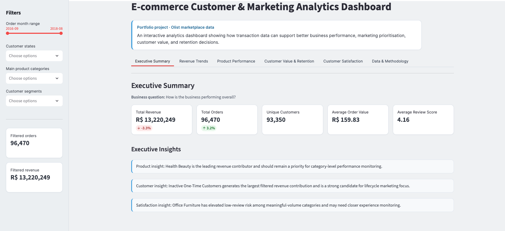
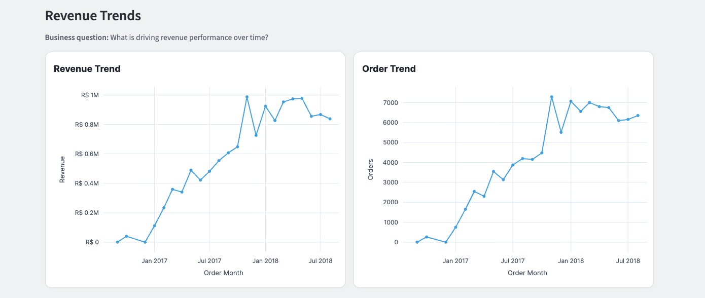
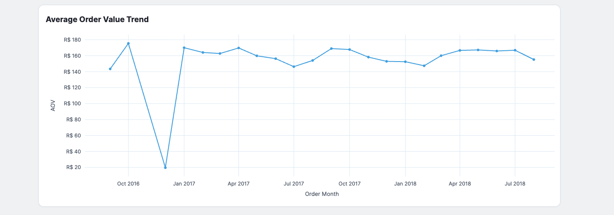
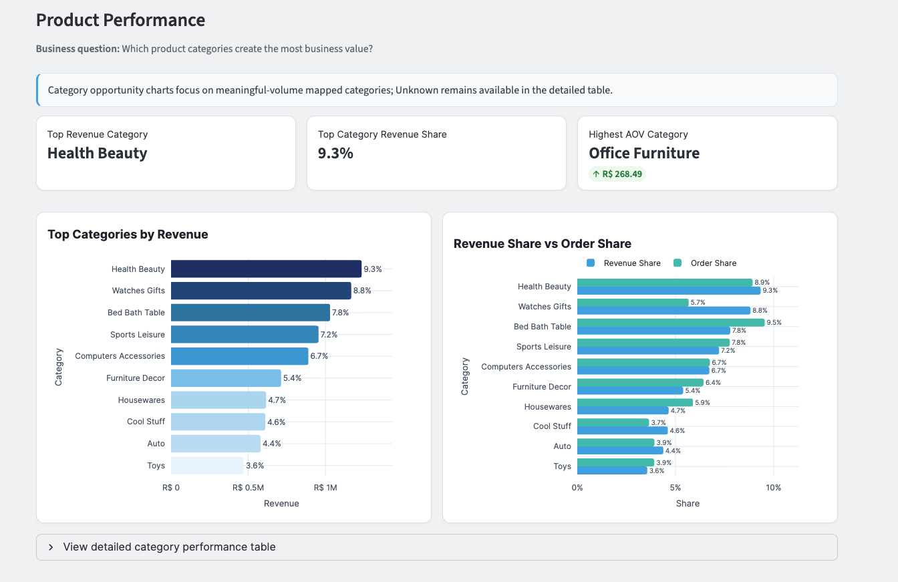
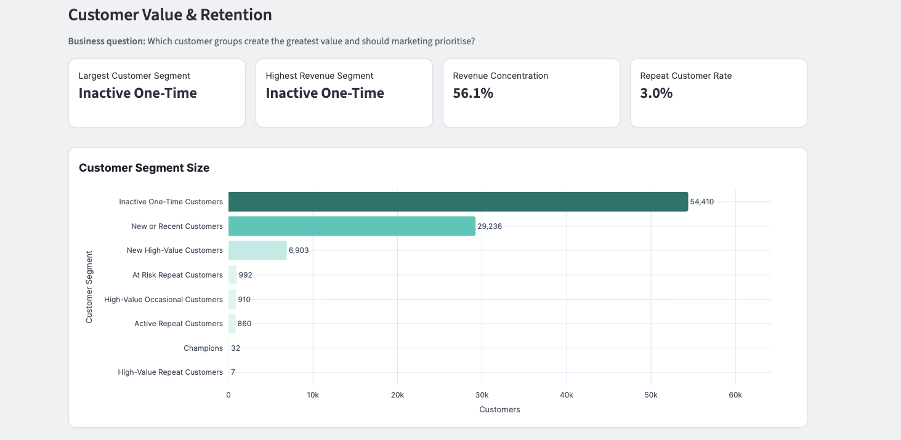
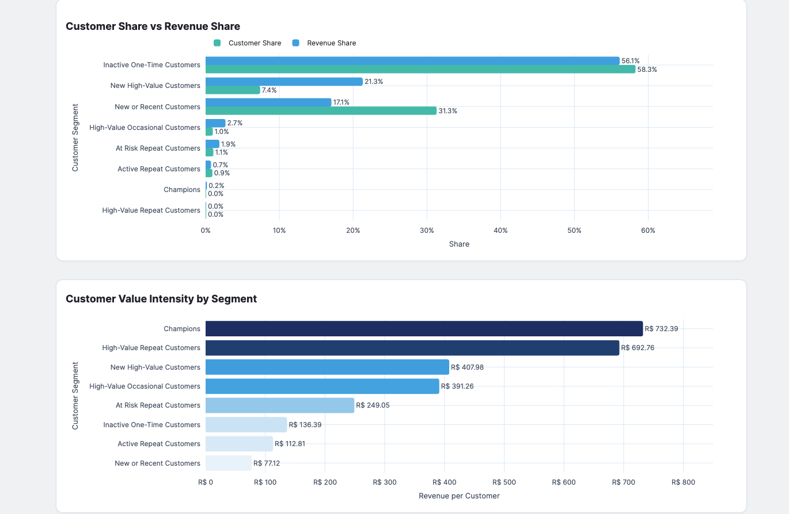
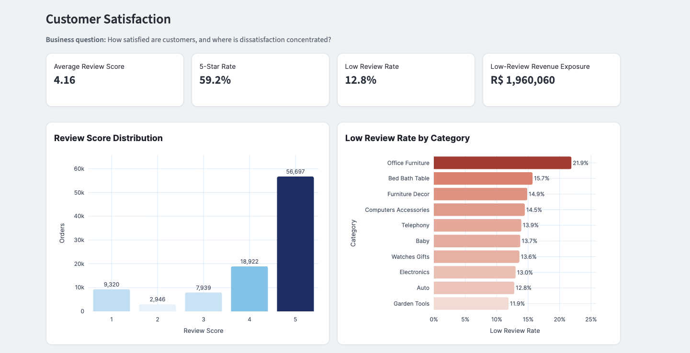
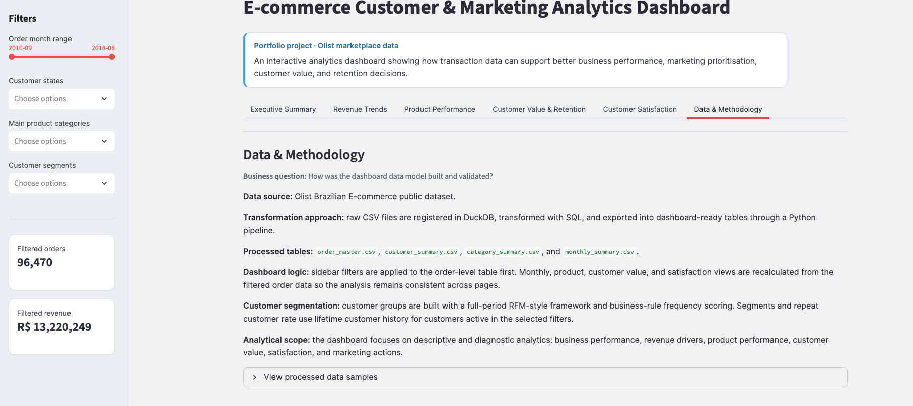

# E-commerce Customer & Marketing Analytics Dashboard

An interactive portfolio project built with the Olist Brazilian e-commerce dataset. It brings together commercial performance, product categories, customer value and customer satisfaction to support business, marketing and CRM decision-making.

> **Portfolio project:** the findings below describe the supplied Olist dataset. They are descriptive observations, not causal conclusions or forecasts.

> **[Open the Live Dashboard](https://ecommerce-marketing-analytics.streamlit.app/)**

## Project Overview

The dashboard is designed for business users who need to understand how sales are performing, which product categories contribute value, how customer groups differ, and where customer feedback may merit further investigation.

The project demonstrates an end-to-end analytics workflow: raw CSV data is transformed with DuckDB SQL, exported into dashboard-ready datasets, and explored through a Streamlit application.

### Business Objectives

- Summarise revenue, order volume, customer counts, average order value and review performance.
- Compare monthly revenue, orders and average order value to understand how commercial performance changes over time.
- Identify product categories that contribute revenue and compare category revenue share with order share.
- Compare customer-segment size, revenue contribution and revenue per customer.
- Locate categories with higher observed low-review rates, while applying a minimum order-volume threshold.

## Live Demo

**[Launch the E-commerce Customer & Marketing Analytics Dashboard](https://ecommerce-marketing-analytics.streamlit.app/)**

## Executive Summary: Findings

These figures use the complete processed dataset unless otherwise stated.

- The order-level dataset contains **96,470 orders** from **93,350 unique customers**, covering **September 2016 to August 2018**.
- Item revenue totals **R$13.22 million**. The dashboard's average order value is **R$159.83** and includes freight, while the revenue measure excludes freight; these are different measures and should not be treated as a direct reconciliation.
- **November 2017** is the highest-revenue month in the available monthly data, at **R$987,648** across **7,288 orders**. Compared with October 2017, revenue was up **52.4%** and orders were up **62.8%**, while average order value was lower. The data alone does not establish why this increase occurred.
- **Health & Beauty** is the largest category by revenue, with **R$1.23 million** or **9.3%** of item revenue. **Office Furniture** has the highest average order value among categories meeting the dashboard's volume threshold, at **R$268.49**. On the full, unfiltered dataset, that threshold is 964 orders; it changes with sidebar filters.
- **Inactive One-Time Customers** is the largest RFM segment, with **54,410 customers (58.3%)** and **56.1%** of observed item revenue. “Inactive” is a rule-based label in this full-period segmentation, not proof that a customer has churned.
- **59.2%** of non-missing reviews are five-star and **12.8%** are low reviews (score 1 or 2). Office Furniture has the highest low-review rate among mapped categories meeting the full, unfiltered dataset threshold of 964 orders: **21.9%**. The app recalculates category eligibility after filters are applied.

The figures are descriptive. In particular, the November increase should not be attributed to a promotion or Black Friday without additional evidence, and review differences do not establish their cause.

## Dataset and Analytical Scope

The project uses the public Olist Brazilian E-Commerce dataset. The pipeline joins order, customer, item, payment, review, product and category-translation CSV sources. The dashboard analyses order-level data over the observed period of September 2016 to August 2018.

The primary commercial revenue measure is item price (`revenue`) and excludes freight. The dashboard's `order_value` and Average Order Value include freight. They answer different questions, so total revenue is not expected to equal order count multiplied by the displayed AOV.

The analysis is descriptive and diagnostic. It does not estimate incremental campaign impact, establish causal relationships, forecast sales, or measure customer retention by acquisition cohort.

## Data Pipeline and Architecture

```text
Olist source CSVs
        ↓
Python build pipeline + DuckDB SQL
        ↓
Four processed CSV datasets
        ↓
Streamlit dashboard and interactive filters
```

[`scripts/build_tables.py`](scripts/build_tables.py) loads the source files into DuckDB, executes the SQL transformations, and writes the processed datasets to `data/processed/`. The Streamlit app reads those processed CSVs; it does not rebuild them at application startup.

## Dashboard Walkthrough

The sidebar provides an order-month range, customer-state, product-category and customer-segment filters. Dashboard views are recalculated from the filtered order-level data. Customer segments themselves are assigned from each customer's full observed dataset history and remain fixed when the dashboard date filter changes.

### 1. Executive Summary

**Business Question:** How is the business performing overall?

**What it shows:** Total revenue, orders, unique customers, average order value and average review score. Revenue and order deltas compare the latest eligible month with the previous eligible month in the selected period.

**Key Finding:** Across the complete dataset there are 96,470 orders, 93,350 unique customers, R$13.22 million in item revenue, R$159.83 average order value including freight, and a 4.16 average review score.

**Business Interpretation:** This provides a high-level baseline for commercial scale and customer feedback. The item-revenue and AOV definitions differ because AOV includes freight.

**Practical Recommendation:** Use this page as a starting point, then examine the revenue, product, customer and satisfaction tabs to understand where performance is concentrated. Treat month-to-month changes as signals for investigation, not explanations by themselves.



### 2. Revenue Trends

**Business Question:** What is changing in revenue performance over time?

**What it shows:** Monthly item revenue, distinct order count and average order value for months present in the filtered order data. Low-volume months are included, so interpret early-period points in light of their smaller order counts.

**Key Finding:** November 2017 recorded the highest monthly revenue, R$987,648 across 7,288 orders. Against October 2017, revenue increased 52.4% and orders increased 62.8%; AOV moved down from approximately R$167.73 to R$158.24.

**Business Interpretation:** The month’s revenue increase coincided with a larger increase in order volume, while average order value declined. The charts identify this pattern but cannot identify its cause. No promotion, seasonal event or campaign attribution is inferred.

**Practical Recommendation:** Investigate campaign calendars, pricing, product availability and traffic or conversion data for the period before assigning a driver. For ongoing monitoring, review revenue alongside both orders and AOV rather than interpreting revenue alone.





### 3. Product Performance

**Business Question:** Which product categories create the most business value?

**What it shows:** Top categories by item revenue, revenue share versus order share, category-level KPIs and a detailed performance table. The table includes orders, customers, revenue, AOV, average review and low-review rate. Category eligibility is recalculated for the current filtered order count as `max(50, int(1% of filtered orders))`; **964 orders** is the threshold for the full, unfiltered dataset. Category rankings and the highest-AOV comparison can therefore change with sidebar filters.

**Key Findings:**

- Health & Beauty leads item revenue with **R$1,234,349 (9.3%)**.
- Watches & Gifts contributes **R$1,166,358 (8.8%)**; Bed Bath Table contributes **R$1,029,813 (7.8%)**.
- In the full, unfiltered dataset, Office Furniture has the highest AOV among categories meeting the 964-order eligibility threshold: **R$268.49**. The app recalculates eligibility under sidebar filters, so the ranking may change for a filtered selection.
- Revenue share and order share can diverge. For example, Watches & Gifts contributes about **8.8% of revenue** and **5.7% of orders**, indicating higher revenue per order than its order share alone suggests. This is an association in the observed data, not an explanation of why.

**Business Interpretation:** Revenue identifies scale; comparing it with order share helps distinguish categories whose revenue contribution is proportionally larger or smaller than their order volume. Higher category AOV is not by itself evidence of stronger profitability, margin or marketing efficiency.

**Practical Recommendation:** Use revenue share and order share to shortlist categories for commercial review. Before reallocating marketing spend, combine these observations with margin, inventory, acquisition cost and campaign-performance data, which are not included here.



### 4. Customer Value & Retention

**Business Question:** Which customer groups contribute the greatest observed value, and how does their value compare with their size?

**What it shows:** Segment size, customer share versus revenue share, revenue per customer, summary KPIs and a detailed segment table. The dashboard's repeat customer rate counts customers with more than one order in the available dataset; it is not a cohort-based retention rate.

**Key Findings:**

- Inactive One-Time Customers are **54,410 customers (58.3%)** and account for **56.1%** of observed item revenue.
- New High-Value Customers are **6,903 customers (7.4%)** and contribute **21.3%** of observed item revenue.
- New or Recent Customers are **29,236 customers (31.3%)** and contribute **17.1%** of observed item revenue.
- The overall observed repeat customer rate is **3.0%**: 2,801 of 93,350 customers have more than one order in the dataset.
- The 32 customers labelled Champions average **R$732.39** in item revenue per customer, but together contribute about **0.18%** of total item revenue. The segment is small, so its average should be interpreted alongside its count and total contribution.

**Business Interpretation:** Segment shares show how observed customer counts and revenue are distributed under the project's rules. The “Inactive One-Time” group’s large historical revenue reflects accumulated one-time purchases; it does not establish current inactivity, future churn, or customer lifetime value beyond the observed period. The repeat rate is a whole-dataset repeat-purchase proportion, not a time-bounded cohort retention measure.

**Practical Recommendation:** Treat New High-Value Customers as a group to investigate for second-purchase opportunities and compare segment-level value before designing lifecycle activity. Validate any proposed targeting with campaign, margin and customer-level time-series data; this dashboard does not measure intervention impact.





### 5. Customer Satisfaction

**Business Question:** How are customers rating their orders, and where are low reviews concentrated?

**What it shows:** Average review score, five-star rate, low-review rate, revenue associated with low-reviewed orders, review-score distribution and category low-review rates. Low reviews are scores of 1 or 2. Category risk comparisons use a dynamically recalculated minimum of `max(50, int(1% of filtered orders))`; 964 orders is the threshold for the full, unfiltered dataset. The ranked opportunity chart excludes the Unknown category; Unknown remains in detailed data where present.

**Key Findings:**

- The average review score is **4.16**.
- **59.2%** of non-missing reviews are five-star; **12.8%** are scores of 1 or 2.
- Reviews are missing for **646 of 96,470 orders**; review-rate percentages use non-missing reviews as the denominator.
- Low-reviewed orders are associated with **R$1.96 million** in item revenue, approximately **14.8%** of total item revenue. This is revenue on orders with low review scores, not revenue proven to have been lost because of dissatisfaction.
- In the full, unfiltered dataset, Office Furniture has the highest low-review rate among mapped categories meeting the 964-order threshold: **21.9% across 1,249 orders**. The threshold and eligible-category ranking can change with sidebar filters.

**Business Interpretation:** The results point to areas where customer feedback merits investigation. They do not establish whether product quality, fulfilment, expectations or another factor caused a low score, nor do they prove a future retention effect.

**Practical Recommendation:** Review low-scoring order comments and operational or product details for categories with sufficient volume. Prioritise investigation using both the rate and underlying order count, and avoid treating low-review revenue exposure as a causal estimate.



### 6. Data & Methodology

**Business Question:** How were the dashboard datasets created, and what are the important analytical assumptions?

**What it shows:** Source and transformation notes, segmentation methodology, analytical scope and expandable samples of processed datasets.

**Key Finding:** The processed order master has 96,470 unique orders and 93,350 unique customers. The customer summary contains one row per unique customer. The four processed files are generated by the SQL build pipeline and consumed by the app.

**Business Interpretation:** The dashboard is reproducible from its data transformation pipeline, but its findings inherit the source data's period, completeness and metric definitions. Customer segmentation is based on full observed history, whereas most page metrics respond to the selected filters.

**Practical Recommendation:** When reusing the dashboard or comparing results, preserve the metric definitions, date scope and segmentation version. Rebuild processed files from the documented source inputs and SQL before publishing changed analytical logic.



## RFM Segmentation Methodology

Customer segments are created in [`sql/02_customer_summary.sql`](sql/02_customer_summary.sql) from each customer's full observed purchase history. They are joined to order-level records and are not recalculated when a dashboard date filter is changed.

- **Recency:** days since the customer's latest order, measured relative to the maximum purchase timestamp in the dataset. `NTILE(5)` orders recency days descending, with `customer_unique_id` as a stable tie-breaker; lower recency therefore receives a higher recency score.
- **Monetary:** total item revenue per customer. `NTILE(5)` orders monetary value ascending, again using `customer_unique_id` as a stable tie-breaker; higher monetary values receive higher scores.
- **Frequency:** business-rule score rather than a quintile: 1 order → 1; 2 orders → 3; 3 orders → 4; 4 or more orders → 5.
- **At Risk priority:** repeat customers with at least two orders and `recency_score <= 2` are assigned to At Risk Repeat Customers before the High-Value Repeat and High-Value Occasional branches. Other existing segment rules and score thresholds are retained.

The current processed customer distribution is: Inactive One-Time Customers **54,410**; New High-Value Customers **6,903**; New or Recent Customers **29,236**; High-Value Occasional Customers **910**; At Risk Repeat Customers **992**; Active Repeat Customers **860**; Champions **32**; and High-Value Repeat Customers **7**. These are mutually exclusive assignments and total 93,350 customers.

**Limitations:** NTILE scores are relative to this dataset and can change when the population or observation window changes. A dataset-wide recency measure is not a live customer-status measure. “Inactive” and “At Risk” are rule-based classifications, not confirmed churn. High-value describes historical item revenue within this dataset, not profitability or predicted future value. Olist's observed period and predominantly one-order customer base limit retention conclusions.

## Technologies and Skills Demonstrated

- **Python, pandas and Streamlit:** data preparation, metric calculation, interactive filtering and dashboard delivery.
- **DuckDB and SQL:** analytical transformations, aggregation, customer-level scoring and repeatable data builds.
- **Plotly:** interactive time-series and category/customer comparison charts.
- **Business and marketing analytics:** KPI definition, segmentation, revenue contribution analysis, customer feedback analysis and translating observations into appropriately qualified recommendations.
- **Analytics communication:** documenting metric definitions, assumptions, limitations and decision-oriented questions.

## Project Structure

```text
ecommerce-marketing-analytics-dashboard/
├── app.py
├── requirements.txt
├── README.md
├── scripts/
│   └── build_tables.py
├── sql/
│   ├── 01_order_master.sql
│   ├── 02_customer_summary.sql
│   ├── 03_category_summary.sql
│   └── 04_monthly_summary.sql
├── data/
│   ├── raw/                 # Source CSVs; obtain separately, not committed
│   └── processed/           # Four dashboard input CSVs
└── images/                  # Dashboard screenshots
```

The app requires these processed files in `data/processed/`:

- `order_master.csv`
- `customer_summary.csv`
- `category_summary.csv`
- `monthly_summary.csv`

## Run Locally

Python 3.10 or later is recommended.

```bash
git clone https://github.com/Soso-uni/ecommerce-marketing-analytics-dashboard.git
cd ecommerce-marketing-analytics-dashboard
python -m venv .venv
source .venv/bin/activate       # Windows: .venv\Scripts\activate
pip install -r requirements.txt
streamlit run app.py
```

The command-line app expects the four processed CSVs under `data/processed/`. To rebuild those files, place the required Olist source CSVs in the location expected by `scripts/build_tables.py` and run the existing build pipeline. The public Olist dataset is distributed separately and is not included in this repository.

## Limitations and Future Improvements

- The dataset covers a finite historical period and does not provide a current view of customer activity.
- The repeat customer rate is a full-period observed proportion, not cohort retention or a customer-retention curve.
- RFM labels are rule-based and dataset-relative; inactive status does not prove churn.
- Revenue is item price excluding freight, while AOV includes freight. The distinction should be retained in any further comparisons.
- Missing reviews and the threshold used for category comparisons affect interpretation. The dashboard includes available low-volume months in its trends and requires a minimum category order count for ranked low-review comparisons.
- The observed associations do not establish causality. Campaign exposure, margin, acquisition cost, product availability and richer time-based customer data would be needed to assess marketing effectiveness or forecast outcomes.
- Future work could add cohort-based retention, gross margin and campaign performance if suitable data becomes available, and could validate the segment rules against a defined CRM use case.

---

Dashboard screenshots are included under `images/`.
